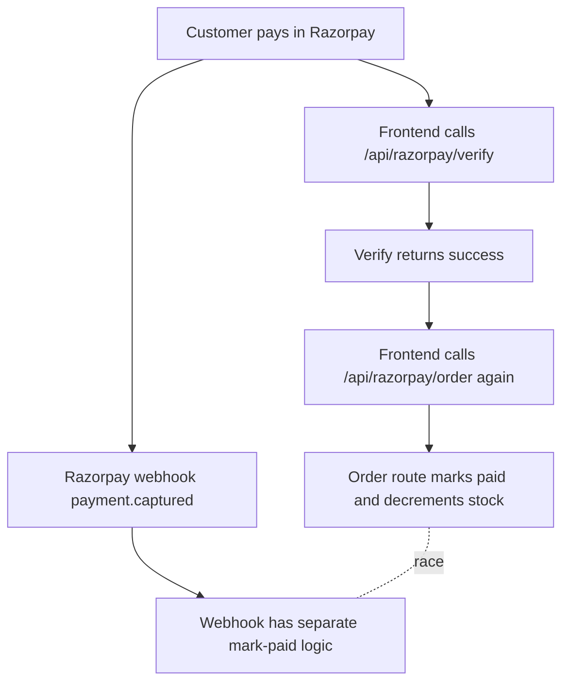
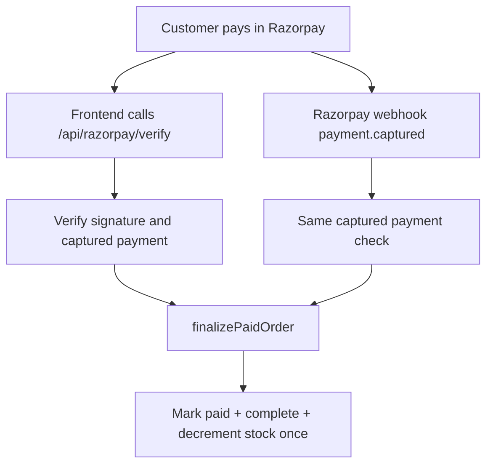

# Razorpay Payment Completion Changes

This document explains the Razorpay order-paid fix in detail, including the before/after behavior and the main code changes.

## Problem Summary

Sometimes Razorpay captured a payment successfully, but the local order stayed unpaid in the database.

The main reason was that the code had more than one place trying to complete the order:

- The frontend called `/api/razorpay/verify`.
- Then the frontend called `/api/razorpay/order` again to complete the order.
- The webhook also had its own separate completion logic.

That created a confusing split-brain payment flow: frontend and webhook could race each other, fail differently, or drift over time.

## Before

### 1. `/api/razorpay/order` Did Two Different Jobs

Before, `app/api/razorpay/order/route.ts` both:

1. Created an unpaid Razorpay + DB order.
2. Completed the order after payment.

Simplified old behavior:

```ts
const isOrderCompletion =
  razorpay_payment_id && razorpay_order_id && razorpay_signature;

if (!isOrderCompletion) {
  // Create Razorpay order.
  // Create DB order with paid: false.
} else {
  // Verify payment signature.
  // Fetch Razorpay order/payment.
  // Mark DB order paid.
  // Decrement stock.
}
```

This made the endpoint harder to reason about because one URL handled two separate lifecycle stages.

### 2. Frontend Made Two Backend Calls After Payment

Before, checkout did this after Razorpay returned a successful payment:

```ts
const verifyRes = await fetch("/api/razorpay/verify", {
  method: "POST",
  headers: { "Content-Type": "application/json" },
  body: JSON.stringify({
    razorpay_payment_id: response.razorpay_payment_id,
    razorpay_order_id: response.razorpay_order_id,
    razorpay_signature: response.razorpay_signature,
  }),
});

const completeOrderRes = await fetch("/api/razorpay/order", {
  method: "POST",
  headers: { "Content-Type": "application/json" },
  body: JSON.stringify({
    razorpay_payment_id: response.razorpay_payment_id,
    razorpay_order_id: response.razorpay_order_id,
    razorpay_signature: response.razorpay_signature,
    userId: user.us.id,
    cartitems: orderItems,
    pricepaid: orderData.amount,
    delivery: del,
    pincode: del ? user.us.pincode : null,
  }),
});
```

So `/api/razorpay/verify` verified the payment, but `/api/razorpay/order` actually completed the local order.

### 3. Webhook Had Separate Completion Logic

Before, the webhook also had its own implementation for:

- Finding the order.
- Marking it paid.
- Decrementing product/accessory stock.
- Retrying missing orders.
- Handling orphan recovery.

That meant frontend completion and webhook completion were not using the same source of truth.

## After

### New Rule

There is now one local source of truth for completing paid orders:

```ts
finalizePaidOrder(...)
```

Both frontend verification and webhook recovery call the same function.

## Files Changed

### 1. New Shared Finalizer

File:

```txt
lib/razorpay/finalize-order.ts
```

Purpose:

- Load the DB order.
- Claim the order only if `paid: false`.
- Mark `paymentid`, `paid`, and `complete`.
- Decrement product/accessory stock.
- Return the completed order.

Code:

```ts
import prisma from "@/lib/prisma";

type FinalizePaidOrderInput = {
  razorpayOrderId: string;
  razorpayPaymentId: string;
};

export async function finalizePaidOrder({
  razorpayOrderId,
  razorpayPaymentId,
}: FinalizePaidOrderInput) {
  return prisma.$transaction(async (tx) => {
    const existingOrder = await tx.order.findUnique({
      where: { id: razorpayOrderId },
      include: {
        orderItems: {
          include: {
            product: true,
            yarnAccessory: true,
          },
        },
      },
    });

    if (!existingOrder) {
      throw new Error(`Order not found: ${razorpayOrderId}`);
    }

    // Idempotency guard: only the first caller can claim this unpaid order.
    // If frontend verification and webhook arrive together, stock is decremented once.
    const claimedOrder = await tx.order.updateMany({
      where: {
        id: razorpayOrderId,
        paid: false,
      },
      data: {
        paymentid: razorpayPaymentId,
        paid: true,
        complete: true,
      },
    });

    if (claimedOrder.count === 0) {
      return tx.order.findUnique({
        where: { id: razorpayOrderId },
        include: {
          orderItems: {
            include: {
              product: true,
              yarnAccessory: true,
            },
          },
        },
      });
    }

    for (const orderItem of existingOrder.orderItems) {
      if (orderItem.productId) {
        const updatedProduct = await tx.product.update({
          where: { id: orderItem.productId },
          data: { stock: { decrement: orderItem.quantity } },
          select: { stock: true, pname: true },
        });

        if (updatedProduct.stock < 0) {
          throw new Error(`Insufficient stock for product ${updatedProduct.pname}.`);
        }
      } else if (orderItem.yarnAccessoryId) {
        const updatedAccessory = await tx.yarnAccessory.update({
          where: { id: orderItem.yarnAccessoryId },
          data: { stock: { decrement: orderItem.quantity } },
          select: { stock: true, name: true },
        });

        if (updatedAccessory.stock < 0) {
          throw new Error(`Insufficient stock for accessory ${updatedAccessory.name}.`);
        }
      }
    }

    return tx.order.findUnique({
      where: { id: razorpayOrderId },
      include: {
        orderItems: {
          include: {
            product: true,
            yarnAccessory: true,
          },
        },
      },
    });
  });
}
```

### Why This Fixes the Race

The key line is:

```ts
where: {
  id: razorpayOrderId,
  paid: false,
}
```

Only the first request can update an unpaid order to paid.

If the frontend and webhook arrive at the same time:

1. First caller updates `paid: false` to `paid: true`.
2. First caller decrements stock.
3. Second caller sees no unpaid row to claim.
4. Second caller returns the already-completed order.
5. Stock is not decremented twice.

## 2. `/api/razorpay/order` Is Now Create-Only

File:

```txt
app/api/razorpay/order/route.ts
```

Before:

- Created unpaid orders.
- Also completed paid orders.

After:

- Only creates unpaid Razorpay + DB orders.
- Payment completion moved to `/api/razorpay/verify`.

Important comment added:

```ts
// This endpoint only creates unpaid Razorpay/DB orders.
// Paid completion now happens in /api/razorpay/verify via the shared finalizer.
```

Current simplified structure:

```ts
export async function POST(req: NextRequest) {
  const aut = await auth();
  if (!aut?.user) {
    return NextResponse.json({ success: false, error: "Unauthorized" }, { status: 401 });
  }

  try {
    const razorpay = new Razorpay({
      key_id: process.env.RAZORPAY_KEY_ID.trim(),
      key_secret: process.env.RAZORPAY_KEY_SECRET.trim(),
    });

    const body = await req.json();
    const { phoneno, cartitems, pincode, delivery, userId } = body;

    // Validate cart and delivery details.
    // Calculate server-side amount.
    // Create Razorpay order.
    // Create DB order with paid: false and complete: false.
    // Return orderId and amount to frontend.
  } catch (err: any) {
    return NextResponse.json(
      { success: false, error: "Order processing failed" },
      { status: 500 }
    );
  }
}
```

## 3. `/api/razorpay/verify` Is Now Verify + Complete

File:

```txt
app/api/razorpay/verify/route.ts
```

Before:

- Frontend path mostly verified Razorpay signature.
- Webhook path had separate completion logic.

After:

- Frontend path verifies signature and completes the order.
- Webhook path is backup recovery and calls the same finalizer.

### Shared Captured Payment Check

Code:

```ts
async function finalizeCapturedPayment(paymentId: string, orderId: string) {
  const razorpay = getRazorpayClient();
  const razorpayPayment = await razorpay.payments.fetch(paymentId);

  if (razorpayPayment.order_id !== orderId) {
    throw new Error(`Payment ${paymentId} does not belong to order ${orderId}`);
  }

  if (razorpayPayment.status !== "captured") {
    throw new Error(`Payment ${paymentId} is not captured`);
  }

  const order = await prisma.order.findUnique({
    where: { id: orderId },
    select: { id: true, pricepaid: true },
  });

  if (!order) {
    throw new Error(`Order not found: ${orderId}`);
  }

  if (razorpayPayment.amount !== Math.round(order.pricepaid * 100)) {
    throw new Error(`Amount mismatch for order ${orderId}`);
  }

  // This is the only local completion path: mark paid + complete + reduce stock.
  // It is safe for both frontend verification and webhook recovery to call it.
  return finalizePaidOrder({
    razorpayOrderId: orderId,
    razorpayPaymentId: paymentId,
  });
}
```

### Frontend Verification Flow

Code:

```ts
async function handlePaymentVerification(body: any) {
  const session = await auth();
  if (!session?.user) {
    return NextResponse.json({ success: false, error: "Unauthorized" }, { status: 401 });
  }

  const { razorpay_order_id, razorpay_payment_id, razorpay_signature } = body;

  const generatedSignature = crypto
    .createHmac("sha256", process.env.RAZORPAY_KEY_SECRET!)
    .update(`${razorpay_order_id}|${razorpay_payment_id}`)
    .digest("hex");

  if (generatedSignature !== razorpay_signature) {
    return NextResponse.json({ success: false, error: "Invalid signature" }, { status: 400 });
  }

  const order = await prisma.order.findUnique({
    where: { id: razorpay_order_id },
    select: { id: true, userId: true },
  });

  if (!order) {
    return NextResponse.json({ success: false, error: "Order not found" }, { status: 404 });
  }

  if (order.userId !== session.user.id) {
    return NextResponse.json({ success: false, error: "Unauthorized" }, { status: 403 });
  }

  const completedOrder = await finalizeCapturedPayment(
    razorpay_payment_id,
    razorpay_order_id
  );

  return NextResponse.json({
    success: true,
    message: "Payment verified and order completed successfully",
    payment_id: razorpay_payment_id,
    order_id: razorpay_order_id,
    order: completedOrder,
  });
}
```

### Webhook Flow

Before, webhook had a separate custom completion path.

After:

```ts
if (body.event === "payment.captured") {
  const payment = body.payload.payment.entity;

  // Webhook is backup recovery, but it uses the same finalizer as the frontend.
  // Razorpay gets 200 only after DB completion succeeds, so failed attempts can retry.
  await finalizeCapturedPayment(payment.id, payment.order_id);

  console.log(`✅ Order completed via webhook: ${payment.order_id}`);
  return new Response("Accepted", { status: 200 });
}
```

This keeps webhook useful, but prevents it from becoming a second independent source of truth.

## 4. Checkout Frontend Is Simpler

File:

```txt
app/(Customerside)/(needauth)/checkout/form.tsx
```

Before:

```ts
// First call: verify
const verifyRes = await fetch("/api/razorpay/verify", ...);

// Second call: complete order
const completeOrderRes = await fetch("/api/razorpay/order", ...);
```

After:

```ts
const verifyRes = await fetch('/api/razorpay/verify', {
  method: 'POST',
  headers: { 'Content-Type': 'application/json' },
  body: JSON.stringify({
    razorpay_payment_id: response.razorpay_payment_id,
    razorpay_order_id: response.razorpay_order_id,
    razorpay_signature: response.razorpay_signature,
  }),
});

const verifyData = await verifyRes.json();
if (!verifyRes.ok || !verifyData.success) {
  if (verifyData.error?.includes('stock') || verifyData.error?.includes('Insufficient')) {
    showAlert('Stock Issue', 'Items became unavailable. Payment will be refunded.', 'error', () => router.push('/orders'));
    return;
  }
  console.log('Verification failed, polling order:', orderData.orderId);
  await pollOrderStatus(orderData.orderId);
  return;
}

// /api/razorpay/verify is now the single source of truth:
// it verifies payment, marks the order paid, and decrements stock.
showAlert(
  'Order Placed Successfully!',
  `Your ${del ? 'delivery' : 'pickup'} order #${orderData.orderId.slice(-8)} has been confirmed.`,
  'success',
  () => {
    ClearBasket();
    router.push('/orders');
  }
);
```

Now the frontend only makes one completion-related call.

## 5. Accessory Order Status Fix

File:

```txt
app/api/check-order/[orderId]/route.ts
```

Before:

```ts
orderItems: { include: { product: true } },
```

And:

```ts
orderItems: order.orderItems.map(item => ({
  productId: item.product.id,
  productName: item.product.pname,
  quantity: item.quantity,
})),
```

Problem:

- Yarn accessory order items do not have `item.product`.
- This could crash when polling/checking accessory orders.

After:

```ts
orderItems: { include: { product: true, yarnAccessory: true } },
```

And:

```ts
orderItems: order.orderItems.map(item => ({
  productId: item.product?.id || item.yarnAccessory?.id,
  productName: item.product?.pname || item.yarnAccessory?.name || "Unknown item",
  quantity: item.quantity,
})),
```

Now both product and accessory orders can be checked safely.

## Before vs After Flow

### Before Flow



Risk:

- Two separate completion paths.
- Duplicate stock decrement possible.
- One path could fail while another succeeds.
- More moving parts during payment success.

### After Flow



Benefit:

- One local finalization function.
- Frontend is the main path.
- Webhook is backup recovery.
- Race-safe idempotency guard.

## Validation

TypeScript validation passed:

```bash
./node_modules/.bin/tsc --noEmit --pretty false
```

No TypeScript errors were reported.

## Important Notes

### Webhook Behavior

Webhook now waits for DB completion before returning `200`.

That is intentional:

- If DB completion fails, Razorpay can retry the webhook.
- Before, the webhook returned `200` immediately and did DB work later.
- Returning `200` early could hide failures from Razorpay.

### Stock Error Behavior

If stock becomes unavailable after payment:

- `/api/razorpay/verify` returns an error containing the stock issue.
- Frontend shows the existing stock issue alert.
- The customer is sent to `/orders`.

This still needs an operational refund process if payment was captured but stock is unavailable.

### Current Source of Truth

The source of truth is now:

```txt
Razorpay captured payment + local finalizePaidOrder()
```

Frontend verification is primary.

Webhook is backup.

